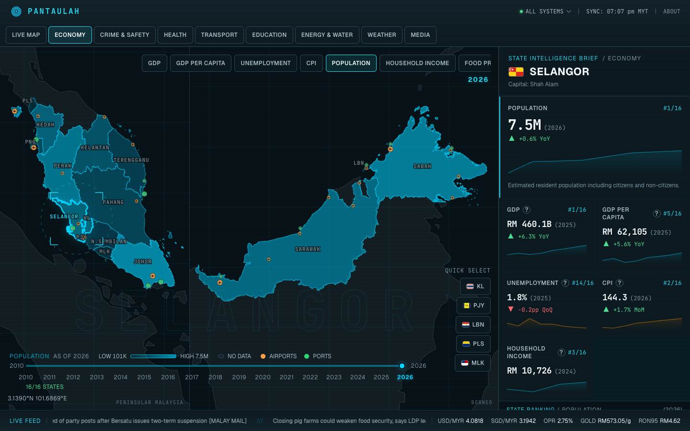

<p align="center">
  
</p>

<h1 align="center">PANTAULAH</h1>

<p align="center">Malaysia, at a glance.</p>

<p align="center">
  <a href="https://pantaulah.com">Explore the dashboard</a> ·
  <a href="docs/DATA.md">Data sources</a> ·
  <a href="CONTRIBUTING.md">Contribute</a>
</p>

An interactive dashboard for Malaysia. Click a state to see how it compares, or open the live map to watch rain, rivers, buses, trains, and aircraft move across the country.



## Why Pantaulah

- **The whole country on one map.** Compare all 16 states and federal territories on 50+ official metrics.
- **Live, not only statistics.** Rain radar, river levels, buses, trains, and aircraft update while you watch.
- **Honest about dates.** Every statistic shows its year, and the top bar shows which live feeds are working.
- **Free and open source.** No sign-up to use it. No API keys to run it yourself.

## What's inside

| Tab | What you can do |
| --- | --- |
| **Live map** | Turn on 20 layers in three groups. **Sky:** rain radar, clouds, wind, PM2.5 smog, satellite haze, day and night. **Ground:** aircraft, buses and trains, rail lines, highway CCTV, news pins, earthquakes, rivers, flood shelters, fire detections. **Surface:** 3D buildings, 3D terrain, population, night lights, tree loss. Use a quick view for weather, travel, or environment, or select a bus or train and follow it as it moves. |
| **Economy** | GDP, unemployment, CPI, population, and household income by state, with sector breakdowns and national figures such as trade, inflation, and the EPF dividend. **Food prices** compares 21 everyday items, such as chicken, eggs, fish, vegetables, and fruit, by state, with exact pack sizes, shop counts, and daily trends. |
| **Crime & safety** | Crime index and rate, homicide rate, drug addicts, and a breakdown by crime type. |
| **Health** | Doctors and hospital beds per 10,000 people, birth, death, and fertility rates, blood donations, organ pledges, PEKA B40 screenings, and daily hospital bed and ICU use. |
| **Transport** | Car and motorcycle registrations, plus rail ridership. |
| **Education** | Schools, enrolment, teachers, student-teacher ratio, completion rate, and literacy rate. |
| **Energy & water** | Electricity use, generation by fuel, water use, water supply, and water access. |
| **Weather** | Live conditions, 3-day forecasts, rain radar and satellite, and weather and flood warnings. **Air quality** shows PM2.5, wind, satellite haze, and fire detections. **Rivers & floods** shows river stations, seven-day river charts, and open shelters. |
| **Media** | Malaysian live TV, trending YouTube videos, Reddit, and news. |

The statistics tabs also show a ticker with news headlines, exchange rates, fuel prices, gold prices, and the overnight policy rate (OPR).

Built with Next.js 16, React 19, TypeScript, MapLibre GL, D3-Geo, and Tailwind CSS. Deployed on Cloudflare Workers through OpenNext.

## Quick start

Use **Node.js 24** and npm. Node.js 24 matches the data-update workflow and supports the optional population-processing script.

```bash
git clone https://github.com/atzr95/pantaulah.git
cd pantaulah
npm ci
cp .env.example .env.local
npm run dev
```

Open [localhost:3000](http://localhost:3000).

Cached statistics and map geometry are included. You do not need to run ingestion to start the app. Core features do not require API keys; live feeds need internet access.

## Optional configuration

| Variable | Purpose |
| ---------- | --------- |
| `YOUTUBE_API_KEY` | Enables trending videos in the Media tab |

See [.env.example](.env.example). Keep credentials in `.env.local` for development and configure them as Worker secrets for deployment.

## Development

```bash
npm test       # Run tests
npm run lint   # Check code style
npm run build  # Build the Next.js app
```

Use `npm run test:watch` while working on tests. For architecture, production builds, and Cloudflare deployment, see the [development guide](docs/DEVELOPMENT.md).

## Data and coverage

Live feeds and historical statistics have different update schedules. Each metric's year and each feed's timestamp matter: refreshing the dashboard does not mean the source has published new data. Coverage also varies by source and location.

See the [data reference](docs/DATA.md) for providers, cache intervals, dataset years, ingestion commands, and map asset generation. A [scheduled workflow](.github/workflows/ingest.yml) refreshes datasets daily at 04:00 MYT.

## Contributing and support

Bug fixes, data corrections, and documentation improvements are welcome. Read [CONTRIBUTING.md](CONTRIBUTING.md) for setup, checks, and pull request guidance.

- Report bugs or incorrect data through [GitHub Issues](https://github.com/atzr95/pantaulah/issues).
- Report vulnerabilities privately using the process in [SECURITY.md](SECURITY.md).
- Read [PRODUCT.md](PRODUCT.md) and [DESIGN.md](DESIGN.md) for product direction and UI guidelines.

## License

Project code is licensed under [MIT](LICENSE). Data, imagery, and map assets remain subject to their providers' terms; see the [data reference](docs/DATA.md#attribution). Pantaulah is an independent project and is not affiliated with its data providers.
